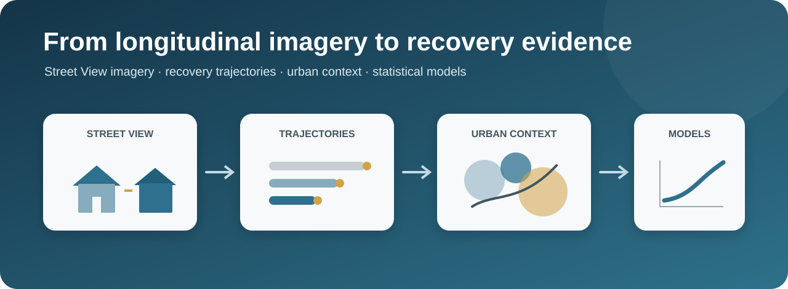
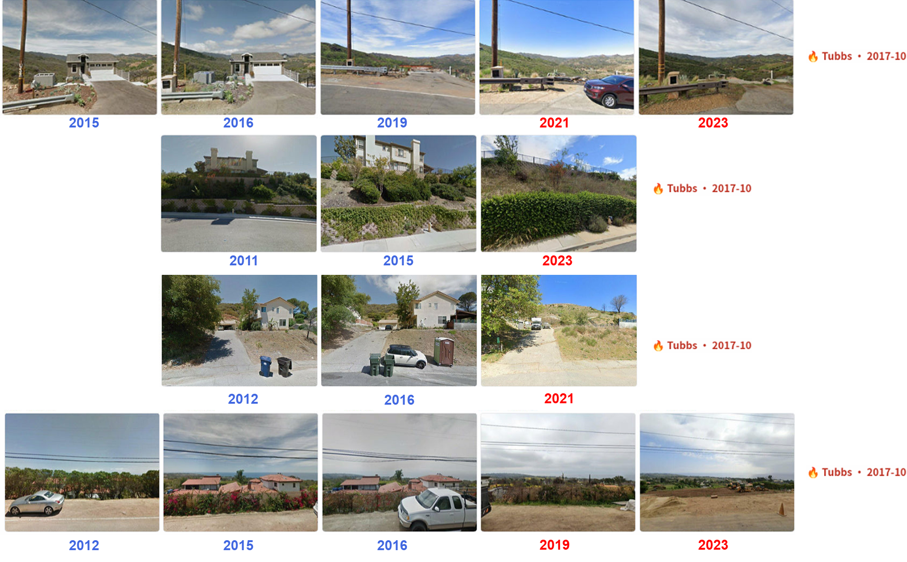
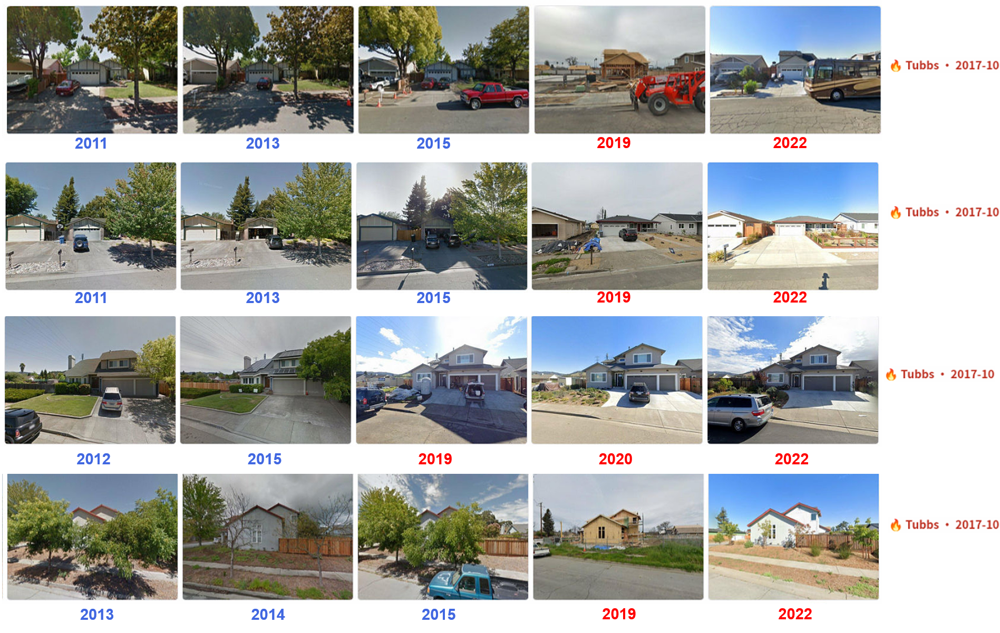
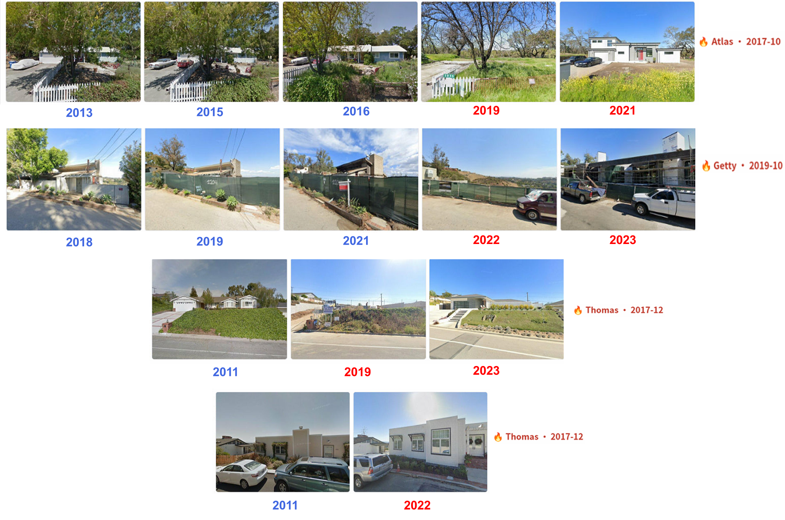
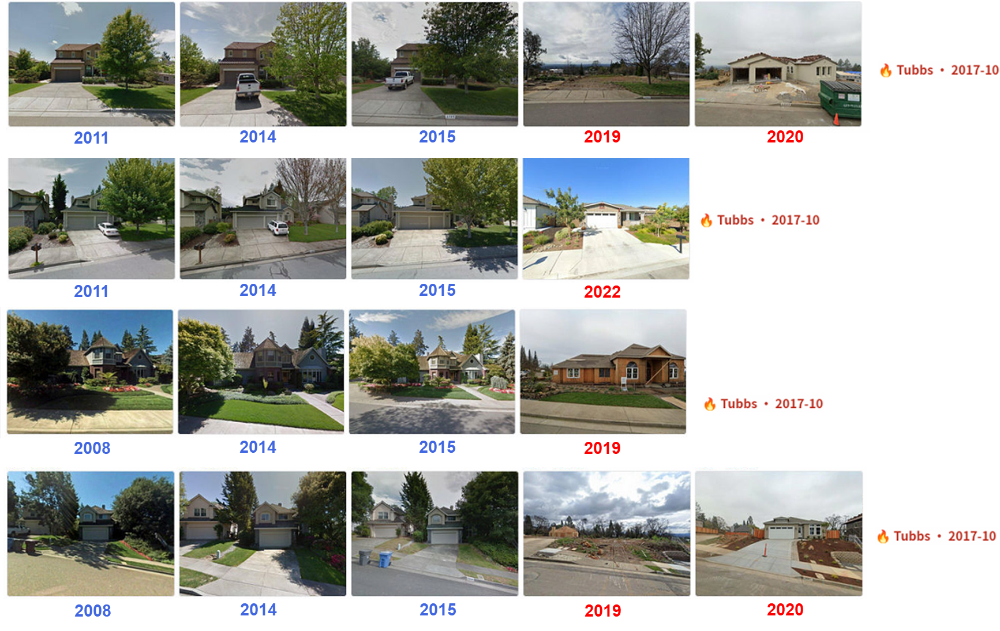
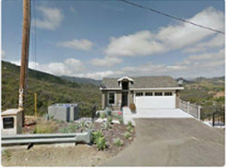
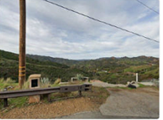

# Post-wildfire housing recovery

A building-level observatory of how communities rebuild after wildfire.

Code and derived numerical data accompanying **Unequal post-wildfire housing recovery follows income and insurance gradients**.

**Collaborating institutions:** National University of Singapore, Massachusetts Institute of Technology, Southeast University, Texas Tech University, Chongqing University, and Tongji University.

The workflow connects visible building recovery and streetscape vegetation change with neighborhood socioeconomic conditions, insurance, mortgage credit, assistance and recorded property transactions.



## Longitudinal recovery examples

The longitudinal image sequences below illustrate the visible recovery outcomes represented in the workflow.

<table>
  <tr>
    <td width="50%" valign="top"><strong>Empty lot</strong><br></td>
    <td width="50%" valign="top"><strong>Rebuilt equal</strong><br></td>
  </tr>
  <tr>
    <td width="50%" valign="top"><strong>Rebuilt improved</strong><br></td>
    <td width="50%" valign="top"><strong>Rebuilt degraded</strong><br></td>
  </tr>
</table>

## Quick start

The prepared-data analyses were run with Python 3.12. No model API calls or image downloads are made by these commands.

```bash
python -m venv .venv
```

Activate the environment on Windows PowerShell:

```powershell
.venv\Scripts\Activate.ps1
```

On macOS/Linux:

```bash
source .venv/bin/activate
```

Install the numerical and plotting dependencies:

```bash
python -m pip install -r requirements.txt
npm install
```

Node.js and Sharp are used for SVG-to-PNG export. The numerical analyses can run without Node.js.

Run all numerical analyses:

```bash
python run.py all
```

Run all numerical analyses and statistical figures:

```bash
python run.py all --figures
```

Completed commands print their output directories. Figures are saved to **outputs/figures/** and formatted tables to **outputs/tables/**.

## Run one result

| Result | Command | Main outputs |
|---|---|---|
| Result 1: overall recovery | `python run.py 1` | Recovery counts, per-fire summaries and observation dates in `outputs/01_recovery_Figure1/` |
| Result 2: income and rebuilding | `python run.py 2 --figures` | `Figure2.png`; income-group proportions and adjusted curves in `outputs/02_income_Figure2/` |
| Figure 3: vegetation | `python run.py vegetation --figures` | `Figure3_vegetation.png`; trajectories in `outputs/02b_vegetation_Figure3/` |
| Result 3: Table 1 models | `python run.py 3` | `outputs/tables/Table1.csv`; full coefficients and model samples in `outputs/03_models_Table1/` |
| Result 4: insurance and finance | `python run.py 4 --figures` | `Figure4.png`; distributions, curves and coefficients in `outputs/04_insurance_Figure4/` |
| Figure 5: transactions | `python run.py 5 --figures` | `Figure5.png`; transaction and tract-income records in `outputs/05_transactions_Figure5/` |
| Supplementary analyses | `python run.py supplementary --figures` | Supplementary tables, Figures 1, 2, 3, 5 and 6, and sensitivity estimates |

Result 1 exports numerical summaries and geographical source data. Named Python entry points are also available in `entries/`; for example, `python entries/02_Result2_Figure2.py` runs Result 2 and its figure.

## Run a supplementary item

```bash
python run.py supplementary --item S14
python run.py supplementary --item S16
python run.py supplementary --item FigureS6 --figures
python run.py supplementary --item Note9
```

Use `S` followed by the table number, `FigureS` followed by the figure number, or `Note9`. Related items sharing one computation are generated together. **RESULTS_INDEX.csv** provides the item-to-command mapping; **DATA_DICTIONARY.csv** describes input fields.

## Read the results

- `outputs/figures/`: statistical figures in PNG and, where available, PDF/SVG.
- `outputs/tables/`: formatted Table 1 and supplementary tables as CSV.
- `outputs/01_*` through `outputs/05_*`: full coefficients, model samples, distributions and prediction curves.
- `outputs/supplementary/`: observation-window counts, structure/time sensitivity models, insurance definitions and leave-one-fire-out estimates.

Runtime messages are stored in `logs/` when running all analyses.

## Local illustration assets

Vegetation curves are generated from the supplied measurements. To assemble the photographic panel of Figure 3 as well, provide the selected local segmentation examples and configure their directory:

```bash
python configure_local_assets.py /path/to/local_plot_assets
python run.py vegetation --figures
```

With these assets configured, the command also generates the complete `Figure3.png`. The bulk Street View image collection remains separate from the numerical data. Existing illustrative examples and input templates in this repository remain available.

## Image acquisition and measurement tools

The original tools are retained for users preparing new image inputs. They operate on locally supplied images or authorized panorama references. Install their additional dependencies as needed:

```bash
python -m pip install -r requirements-upstream.txt
```

Retrieve an image using your own Google Maps API key:

```bash
python code/streetview_api_example.py --panoid PANO_ID --heading 180 --output local_data/example.jpg
```

Set `GOOGLE_MAPS_API_KEY` as an environment variable before running the downloader. For recovery classification, set `ANTHROPIC_API_KEY` and supply chronological images of the same building:

```bash
python code/trajectory_classification_example.py --images local_data/pre.jpg local_data/post.jpg --model claude-opus-4-7
```

### Run the minimal Street View test

The repository includes one real pre- and post-fire image pair from the
longitudinal examples above. It provides a minimal input for checking the
classification interface.

<table>
  <tr>
    <td width="50%" valign="top"><strong>Pre-fire (2016)</strong><br></td>
    <td width="50%" valign="top"><strong>Post-fire (2023)</strong><br></td>
  </tr>
</table>

Run:

```bash
python code/trajectory_classification_example.py \
  --images examples/streetview_pre_fire.png examples/streetview_post_fire.png \
  --model claude-opus-4-7
```

The expected trajectory is `empty_lot`; confidence and explanatory text may vary
between API responses. The expected output schema is recorded in
`examples/streetview_expected_output.json`.

After installation, the two-image classification demo typically completes in
under one minute, excluding variation in hosted API response time.

Street View imagery: © Google. Displayed here as a research example and subject
to the Google Maps Platform Terms of Service.

Measure vegetation in locally supplied pre- and post-fire images:

```bash
python code/vegetation_measurement.py --pre-images local_data/pre_1.jpg local_data/pre_2.jpg --post-images local_data/post_1.jpg local_data/post_2.jpg
```

The original standalone `code/statistical_models.py` utility is also retained for prepared tables following its documented schema. Use `run.py` for the result-specific analyses with the supplied data.

## Repository structure

```text
code/          Numerical analyses and original image-processing utilities
entries/       Named entry points for individual results and items
plotting/      Figure-generation routines
data/          Derived numerical inputs, source spreadsheets and boundaries
reference/     Numerical fixtures, table formatting and plot configuration
artwork/       Vector layout assets used by the plotting routines
examples/      Original image-input templates and examples
outputs/       Generated numerical results, tables and figures
```

Input datasets are identified by their hashes and cohort definitions in **data/README.md**. Model-specific samples are exported with the coefficient tables. Machine-specific configuration, API credentials and environment folders are excluded from version control. The manuscript, reviewer responses and supplementary document are not included.

## Project team

[City Syntax Lab](https://github.com/City-Syntax)
